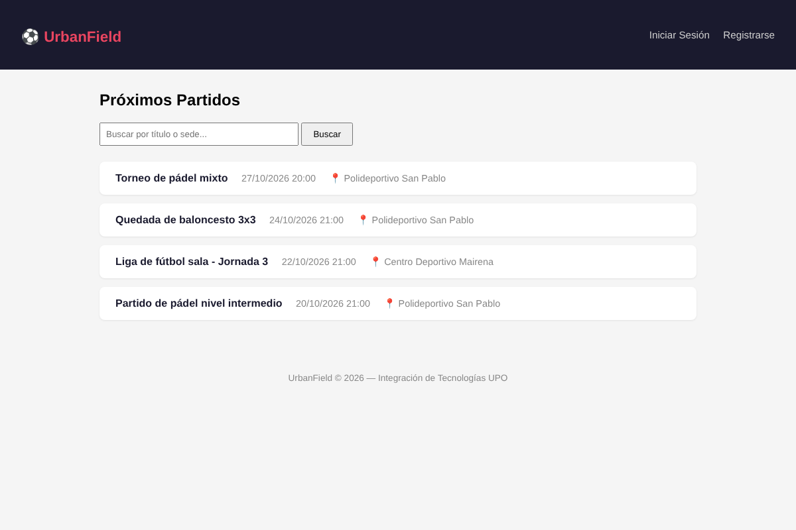
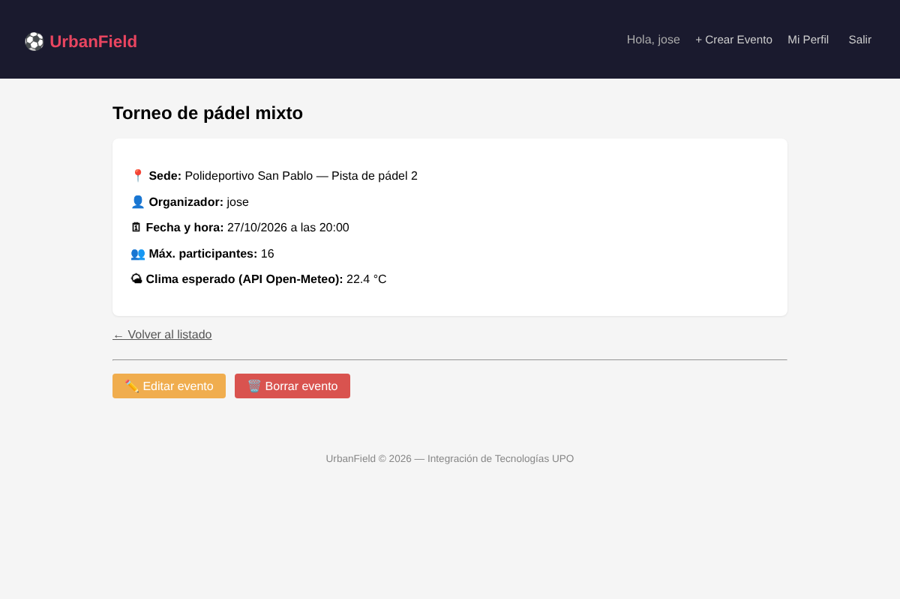
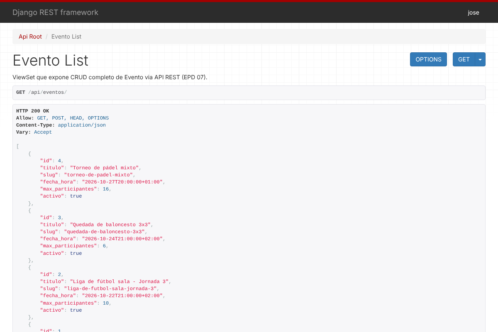

# UrbanField

[](https://github.com/Euchelu/urbanfield/actions/workflows/ci.yml)


Plataforma web para organizar partidos y reservar instalaciones deportivas urbanas (pistas de pádel, fútbol sala, baloncesto…). Los usuarios crean eventos en una sede, el resto los encuentra con el buscador y cada evento muestra la temperatura prevista en la pista gracias a la API de Open-Meteo.

Desarrollada con **Django 5.2**, **Django REST Framework**, **PostgreSQL** y desplegable con **Docker Compose + Nginx**.

| Listado y búsqueda de eventos | Detalle con clima en tiempo real |
|---|---|
|  |  |

## Funcionalidades

- **Cuentas de usuario:** registro, inicio y cierre de sesión, con perfil editable (bio y nivel).
- **CRUD de eventos:** cualquier usuario autenticado puede crear eventos; solo el organizador puede editarlos o borrarlos.
- **URLs legibles:** cada evento tiene un *slug* único generado a partir del título (`/evento/torneo-de-padel/`, `/evento/torneo-de-padel-2/`…).
- **Búsqueda** por título del evento o nombre de la sede.
- **Clima en tiempo real** con Open-Meteo. Si la API falla o tarda más de 5 s, la página sigue funcionando y muestra "No disponible".
- **API REST** en `/api/eventos/`: lectura pública y escritura solo para usuarios autenticados.
- **Configuración por entornos** (`local` con SQLite, `prod` con PostgreSQL) y secretos en variables de entorno.



## Arquitectura

```
Navegador ──► Nginx ──► Gunicorn ──► Django (app "gestion") ──► PostgreSQL
                │                          │
          archivos estáticos               └──► API Open-Meteo (clima)
```

**Modelo de datos:** `Sede` → `Instalacion` → `Evento` ← `Participacion` → `Usuario` ← `Perfil`

```
UrbanField/
├── gestion/                # App principal
│   ├── models.py           # Sede, Instalacion, Evento, Participacion, Perfil
│   ├── views.py            # Vistas, ViewSet de la API y cliente de Open-Meteo
│   ├── serializers.py
│   ├── forms.py
│   ├── templates/
│   └── tests/              # 32 tests: modelos, vistas, permisos, API y clima
├── urbanfield_project/
│   └── settings/
│       ├── base.py         # Configuración común
│       ├── local.py        # Desarrollo (SQLite)
│       └── prod.py         # Producción (PostgreSQL)
├── templates/              # Plantilla base y registro
├── Dockerfile
├── docker-compose.yml      # Django + PostgreSQL + Nginx
└── nginx/default.conf
```

## Puesta en marcha en local

Requisitos: Python 3.11 o superior.

```bash
cd UrbanField
cp .env.example .env              # Cambia SECRET_KEY por una clave propia
python -m venv venv
source venv/bin/activate          # En Windows: venv\Scripts\activate
pip install -r requirements.txt
python manage.py migrate
python manage.py createsuperuser  # Para dar de alta sedes e instalaciones en /admin
python manage.py runserver
```

La aplicación queda disponible en `http://127.0.0.1:8000`.

## Despliegue con Docker

```bash
cd UrbanField
cp .env.example .env              # Configura credenciales reales y ALLOWED_HOSTS
docker compose up --build
```

La aplicación queda disponible en `http://localhost`.

| Variable | Descripción |
|---|---|
| `SECRET_KEY` | Clave secreta de Django |
| `ALLOWED_HOSTS` | Dominios permitidos, separados por comas (producción) |
| `DB_NAME`, `DB_USER`, `DB_PASSWORD`, `DB_HOST`, `DB_PORT` | Conexión a PostgreSQL |

## Tests

La suite cubre modelos, vistas, permisos del organizador, registro, perfil, API REST y la integración con Open-Meteo (con la API simulada, para que los tests no dependan de la red).

```bash
cd UrbanField
pip install -r requirements-dev.txt
SECRET_KEY=dev coverage run --source=gestion --omit='gestion/migrations/*,gestion/tests/*' manage.py test
coverage report
```

GitHub Actions ejecuta los tests en Python 3.11 y 3.12, comprueba que no falten migraciones, exige al menos un 85 % de cobertura y construye la imagen Docker en cada *push* y *pull request*.

## Tecnologías

Python · Django 5.2 · Django REST Framework · PostgreSQL · SQLite · Docker · Docker Compose · Nginx · Gunicorn · Open-Meteo API · GitHub Actions

## Autor

**José Ángel Ceballos Rodríguez** · [Portfolio](https://euchelu.github.io/portfolio/) · [GitHub](https://github.com/Euchelu)

Proyecto desarrollado en la asignatura *Integración de Tecnologías* del Grado en Ingeniería en Sistemas de Información (Universidad Pablo de Olavide).
